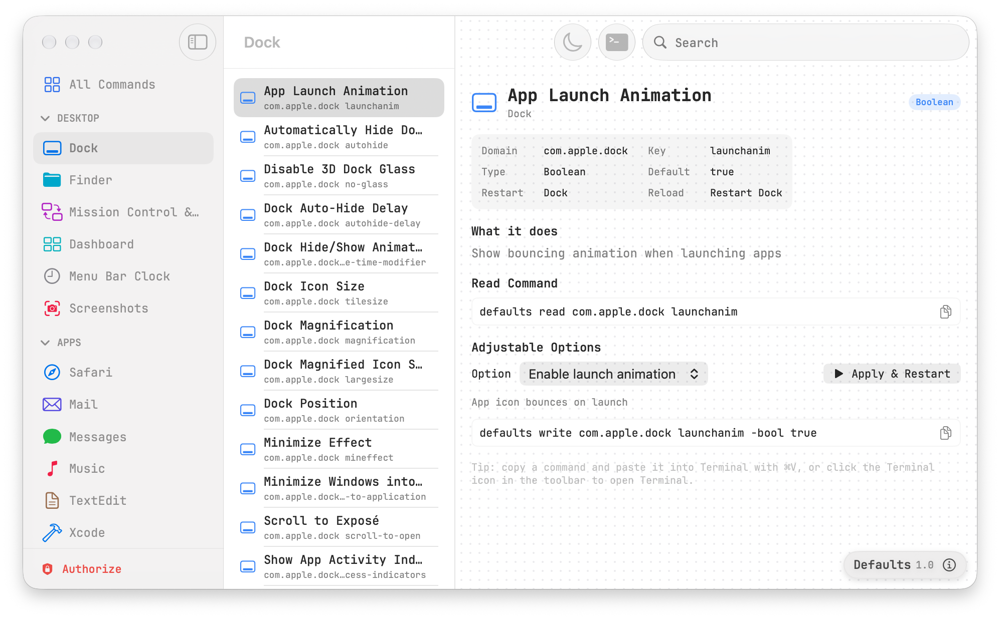

<h1 align="center">Defaults</h1>

<p align="center"><em>Browse and apply the hidden preferences behind macOS — as <code>defaults</code> commands.</em></p>

<p align="center">
  
  
  
  
  
  
</p>

<p align="center">
  
</p>

---

## About

Every hidden macOS preference — where the Dock sits, whether screenshots get a shadow, how Mission Control groups windows — is stored as a preference and can be read and written with the `/usr/bin/defaults` command.

**Defaults** is a native SwiftUI app that lets you browse those preferences, see the exact command each one needs, pick from its values, and apply it — without having to remember or look up any syntax.

Commands are based on [macos-defaults.com](https://macos-defaults.com).

## Features

- **129 commands across 28 categories**, grouped into Desktop, Apps and System
- **Three-column browser** — sidebar, command list and detail
- **Command detail** for each entry: domain, key, value type, current default, restart requirements and a short explanation
- **Value pickers** for every option a command supports (including `-array-add`)
- **Live command preview** — the exact `defaults write …` text, selectable and one copy away
- **Apply & Restart** — runs the change with elevated rights and relaunches the affected app (`killall Dock`, `killall Finder`, …)
- **Run in Terminal** — hands the selected command to Terminal
- **Authorize once** — your password is validated and cached, so applying changes never prompts again while the app is running
- **Risk warnings** for commands that need extra care
- **Settings** with a System / Light / Dark theme switch and permission status
- JetBrains Mono throughout, SF Symbols for every icon, and the real app icons for Safari, Mail, Disk Utility and friends

## Requirements

| Requirement | Details |
|---|---|
| macOS | **27.0 or later** (deployment target) |
| Building | Xcode 27 or newer |
| Rights | an **administrator** account to apply changes — Full Disk Access is *not* needed |
| Font | JetBrains Mono (optional — falls back to a system monospaced font) |

## Installation

### Build from source

```bash
git clone https://github.com/thomasboom/Defaults.git
cd Defaults
open Defaults.xcodeproj
```

Then press **⌘R**. To build from the command line:

```bash
xcodebuild -project Defaults.xcodeproj -scheme Defaults -configuration Release build
```

The project uses a *synchronized folder reference*, so every file under `Defaults/` is compiled automatically — including when you add or move files. If you want to run it on your own machine, pick a signing team in **Signing & Capabilities** first.

## Using the app

### Browse

Pick a category in the sidebar, choose a command from the middle column, and read the details on the right. Use the sidebar's **All Commands** entry with the search field in the toolbar to find something specific.

### Copy or run

Each command offers two paths:

- **Copy** — puts `defaults write …` on the clipboard, ready to paste into Terminal with **⌘V**
- **Run in Terminal** — the Terminal button copies the command and asks Terminal to run it

### Apply & Restart

**Apply & Restart** writes the preference as root and relaunches the app that owns it, using `killall`. For Dock commands that means the Dock briefly disappears and comes back — the change is visible immediately.

Commands that affect the login window or launch services instead show a note that a log out or relaunch is required.

### Authorize

Changes are applied with `sudo`, so the app needs your administrator password. It is requested once (in the app, or from the sidebar's *Authorize* button) and then kept alive, so you are not asked again while the app runs. Revoke it any time from **Settings → Permissions**.

The sidebar's *Authorize* button turns **red** when authorization is missing and **green** once granted.

## Command coverage

The catalog mirrors every macos-defaults.com page that has a `defaults` command. Where the site refers to `NSGlobalDomain` or `kCFPreferencesAnyApplication`, the app uses the shorter global form:

```bash
defaults -g <key> <value>          # instead of: defaults write NSGlobalDomain <key> <value>
```

Categories currently covered:

`Dock` · `Finder` · `Mission Control & Spaces` · `Dashboard` · `Menu Bar Clock` · `Screenshots` · `Safari` · `Mail` · `Messages` · `Music` · `TextEdit` · `Xcode` · `Activity Monitor` · `Simulator` · `System (Global)` · `Keyboard` · `Mouse` · `Trackpad` · `Login Window` · `Screensaver` · `AirDrop` · `Crash Reporter` · `.DS_Store` · `Disk Utility` · `Software Update` · `App Store` · `Time Machine` · `Feedback Assistant`

## Project structure

```
Defaults/                        repository root
├── Defaults/                    the app target — everything here is compiled
│   ├── App/
│   │   ├── MyApp.swift          @main, WindowGroup + Settings scenes
│   │   ├── AppState.swift       authorization, privileged execution, user rights
│   │   └── Theme.swift          JetBrains Mono helper + window metrics
│   ├── Models/
│   │   ├── Models.swift         DefaultsCommand, options, categories, value types
│   │   └── CommandStore.swift   the command catalog
│   ├── Views/
│   │   ├── ContentView.swift    three-column split view
│   │   ├── SidebarView.swift
│   │   ├── CommandDetailView.swift
│   │   ├── SettingsView.swift
│   │   ├── AuthSheet.swift
│   │   ├── InfoBar.swift
│   │   ├── AppIcons.swift
│   │   └── WindowBackdrop.swift
│   └── Assets.xcassets          app icon
├── Docs/
│   └── screenshot.png           image used by this README
├── Tools/
│   └── GenerateAppIcon.swift    developer script, not part of the app
├── Defaults.xcodeproj
├── LICENSE
├── README.md
└── .gitignore
```

`Tools/` and `Docs/` deliberately sit outside the app folder: the project uses a synchronized folder reference, so *everything* under `Defaults/` is compiled into the target.

## Permissions and safety

- Only **administrator (root)** access is used. Full Disk Access is not required, and never was.
- The app sandbox is **disabled**, because the app shells out to `/usr/bin/sudo`, `/usr/bin/defaults` and `killall`.
- Your password is verified once with `sudo -v`, refreshed every 60 seconds so it stays valid while the app runs, and cleared with `sudo -k` when you revoke authorization. Quitting the app lets the credential expire, as `sudo` normally does.
- Nothing is written until you press **Apply & Restart**.
- Commands that can cause trouble are shown with an orange warning banner.

## Development

Everything is plain SwiftUI with no third-party dependencies. The source is laid out in `App/`, `Models/` and `Views/`, and the project needs no edits when files move — the folder reference picks them up.

```bash
# Debug build
xcodebuild -project Defaults.xcodeproj -scheme Defaults -configuration Debug -destination 'platform=macOS' build
```

## Contributing

Issues and pull requests are welcome. If a command is missing, outdated or generated incorrectly, please include the `defaults` command from macos-defaults.com so it can be verified.

## License

Released under the [MIT License](LICENSE).

Copyright © 2026 [Thomas Boom](https://github.com/thomasboom)
